ASMOS - x86 Operating System
=============================================================================

Version 3.1.8

A 32-bit x86 OS for the 386 era, written from scratch in assembly and C. No
external kernel libraries. It looks and feels like a desktop from around
1990 (Windows 3.1 / Mac System 6) and runs on a 386SX with 2 MB of RAM.

It is tested in 86Box (386SX-16, 486, Pentium, Pentium II machines), QEMU
and Bochs. Real hardware: not confirmed yet (I don't have any PCs from that
era, but I'm sure it'll run just fine because it works in 86Box).

[>>> CLICK HERE FOR MY HONEST MESSAGE ABOUT THIS PROJECT <<<](#message-from-me)

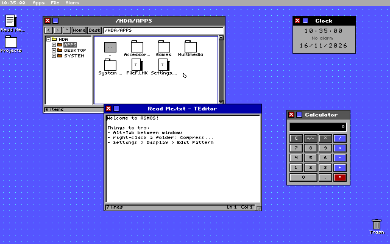

Contents
-----------------------------------------------------------------------------

- [Features](#features)
- [Screenshots](#screenshots)
- [Hardware requirements](#hardware-requirements)
- [Build and run](#build-and-run)
- [Installing on a hard disk](#installing-on-a-hard-disk)
- [Using ASMOS](#using-asmos)
- [Troubleshooting](#troubleshooting)
- [Known limitations](#known-limitations)
- [Known bugs](#known-bugs)
- [How it boots](#how-it-boots)
- [Memory map](#memory-map)
- [Inside the kernel](#inside-the-kernel)
- [Development notes](#development-notes)
- [Source tree](#source-tree)
- [Message from me](#message-from-me)

Features
=============================================================================

- **Desktop**: overlapping windows, a menu bar, desktop icons, a Trash, an
  Apps menu built from the /APPS folder, and a busy hourglass. Alt+Tab and
  Alt+Shift+Tab switch windows.
- **Four screen modes**: 320x200 in 256 colours (fast, Mode 13h), 640x400
  and 640x480 in 16 colours (planar VGA), 800x600 in 16 colours (SVGA). The
  bigger ones only where the machine can take them (see below). Settings >
  System > "Large display: 2x" draws everything twice the size in the
  16-colour modes (800x600 then looks like 400x300, sharp and chunky).
- **Files**: FAT12 floppies and FAT16 hard disks (up to 2 GB), long names
  up to 63 characters, up to 2 hard disks and 2 floppy drives.
- **CD-ROM** (read only): an ATAPI CD drive on IDE shows a disc icon with
  the disc's name, as /CD0. ISO 9660 with Joliet long names. Apps on the
  disc show up under Apps > CDROM while it is in, and go away when it is
  taken out. Right-click the icon to eject.
- **Floppies**: a disk read shows on the desktop. Taking it out is noticed
  by itself (its icon goes); to read one put in, open its drive in FileF's
  Drives. Eject writes what is waiting first.
- **ZIP archives**: compress files and folders, extract archives (Edit menu
  and right-click).
- **Installer**: a 1.44 MB setup floppy installs ASMOS on any IDE disk or
  updates an installed one. The kernel is the hidden file
  `SYSTEM\KERNEL.SYS`.
- **App memory protection**: each .APP runs in its own address space (386
  paging). A crashing app is closed and the rest keeps running.
- **Sound**: Sound Blaster 16 (WAV), OPL2 FM (MIDI), the PC speaker.
- **Network**: NE2000 (ISA, or PCI clones), IPv4 with a static address,
  ping, DNS, a Gopher browser.
- **Printing**: parallel port, plain text, Epson ESC/P or HP PCL, with a
  print queue.
- **Shell**: a command line with a built-in x86 assembler.
- **Power**: Shut Down waits for the disks to stop and saves the settings.
  Machines with APM switch themselves off.
- **No FPU needed**: an x87 emulator steps in when there is no 387.

Screenshots
=============================================================================

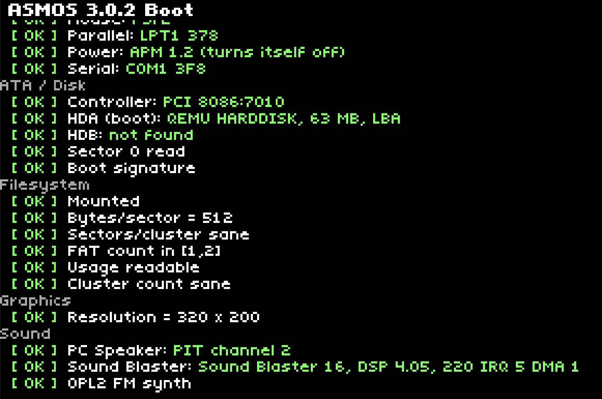

The same desktop at 320x200, for slow machines:

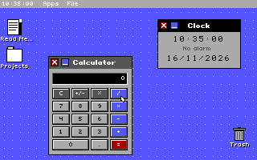

The Apps menu. Each folder in /APPS is a group:

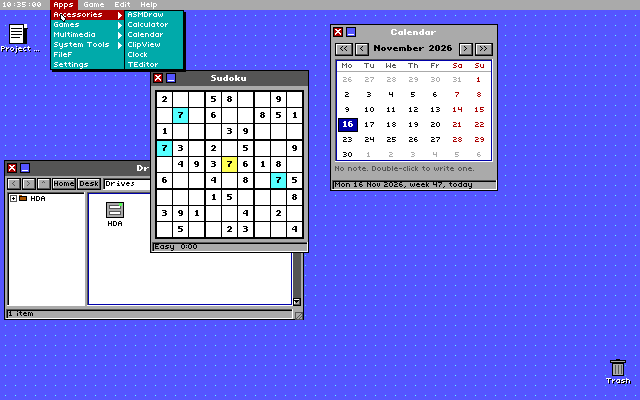

Alt+Tab:

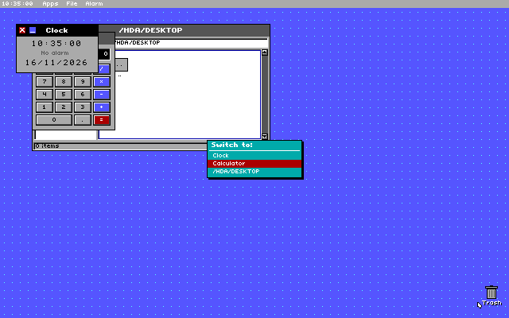

Settings > Display > Edit Pattern. An 8x8 editor for the desktop pattern:

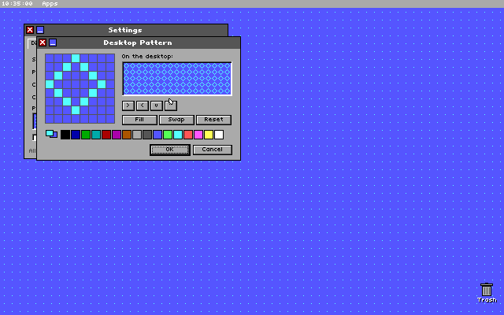

Right-click a folder > Compress...:

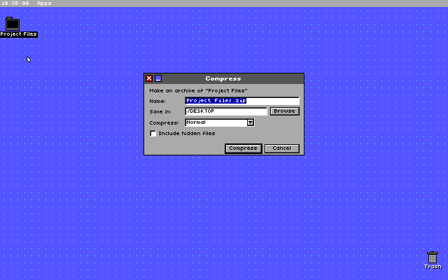

ASMTerm, the shell in a window:

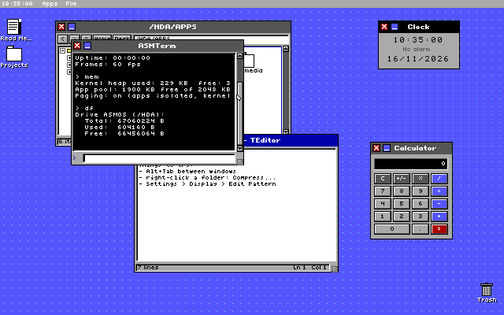

Monitor (Ctrl+Alt+Del): the running apps, End Task, memory and CPU:

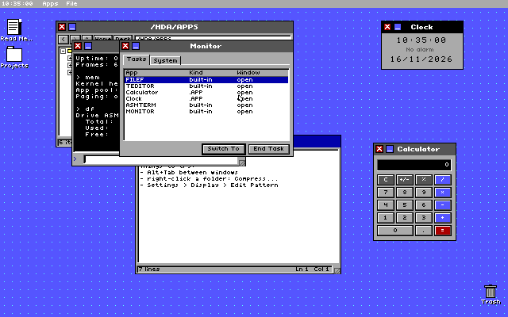

Setup, choosing what to do with the disk:

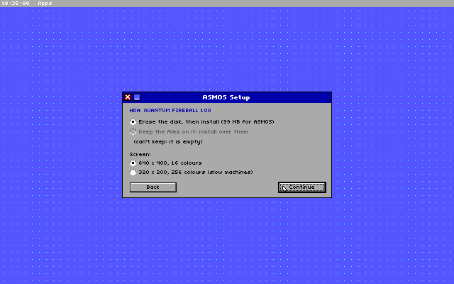

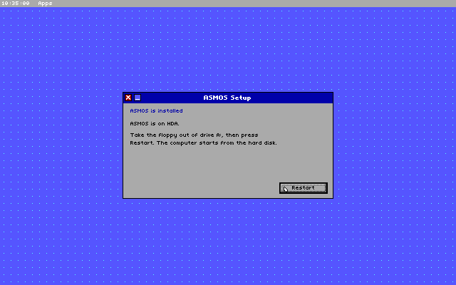

Shutting down:

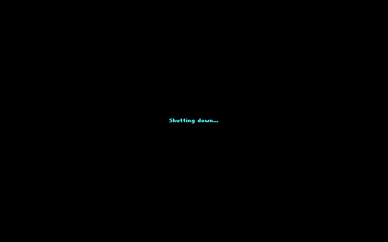

Hardware requirements
=============================================================================

Minimum:

- 386SX or better. A 387 is optional (emulated).
- 2 MB of RAM (4 MB recommended). RAM above 64 MB is not used.
- VGA
- A 1.44 MB floppy drive (to install), an IDE hard disk (to run from)
- PS/2 or serial mouse, PS/2 or AT keyboard

Optional:

- Sound Blaster 16 or compatible (port 220h-280h), OPL2 / AdLib
- NE2000 network card (ISA at 300h, 280h, 320h, 340h, 360h or 240h; or a
  PCI NE2000 clone like the Realtek RTL8029)
- A printer on LPT1-LPT3
- A BIOS with APM and an ATX power supply, to switch off by itself
- An ATAPI (IDE) CD-ROM drive

Speed: usable on a 386SX-16 at 320x200 with the frame rate at 30. Smooth on
a 486 and up.

Screen modes, by machine (the boot loader enforces it; Setup and Settings
only offer what fits):

| Machine                                     | Screens                   |
| ------------------------------------------- | ------------------------- |
| under 3 MB of RAM                           | 320x200                   |
| a 386, 3 MB or more                         | 320x200, 640x400, 640x480 |
| a 486 or better, 3 MB                       | 320x200, 640x400, 640x480 |
| a 486 or better, 4 MB or more, an SVGA card | all, and 800x600          |

The bigger screens need two frames' worth of memory (600 KB at 640x480,
940 KB at 800x600), and 800x600 has 2.3 times the pixels of 640x400: too
much for a 386. 800x600 also needs an SVGA card with that mode in its BIOS
(VESA mode 102h or mode 6Ah: nearly all of them). Without it, ASMOS starts
in 640x480 and the boot log says why.

Build and run
=============================================================================

You need: i686-elf-gcc, nasm, python3, make. QEMU, Bochs or 86Box to run.

```
make              build kernel.bin, os_image.bin (hard disk), setup.img (floppy)
make HDD_MB=200   the hard disk image in another size (up to 2 GB; default 64)
make qemu         run the hard disk image in QEMU
make qemu-fdd     the same, with the setup floppy in drive A:
make qemu-cd      the same, with a CD of the bundled apps (cd.iso) in the
                  CD drive; make qemu-cd CD_ISO=my.iso for another disc
make qemu-setup   run Setup on a new, empty 100 MB disk
make bochs        run in Bochs
make boottest     boot both images in an emulated BIOS, many kinds (see below)
make clean        delete what the build made
```

What `make` builds (tools/mkdisk.py):

- `os_image.bin`: a hard disk with ASMOS installed. The MBR, one FAT16
  partition at sector 63, `SYSTEM\KERNEL.SYS` and /APPS. It is made new on
  every build.
- `setup.img`: the 1.44 MB setup floppy. Booting it starts ASMOS from the
  floppy, straight into Setup.

86Box: attach `os_image.bin` as an IDE hard disk (or `setup.img` as a 1.44
MB floppy) and, in the BIOS setup, run **IDE HDD Auto Detection** for the
disk. See [Troubleshooting](#troubleshooting).

To write the image to a real disk (be careful!):

```
dd if=os_image.bin of=/dev/sdX bs=512
```

Installing on a hard disk
=============================================================================

The full walk-through: [docs/BOOT_AND_SETUP.md](docs/BOOT_AND_SETUP.md).

1. Make the setup floppy (`make`, then `setup.img`) and boot from it.
2. Setup starts by itself. Press Continue.
3. Pick the hard disk.
4. Choose what to do with it:
    - **Erase the disk, then install**: a new partition (FAT16, up to 2 GB).
      Everything on the disk is lost.
    - **Keep the files on it: install over them**: updates an ASMOS disk.
      The boot code, `SYSTEM\KERNEL.SYS` and the bundled apps are replaced.
      Your settings (ASMOS.CFG), desktop and documents stay. Shortcuts you
      deleted from /APPS come back; apps no longer bundled are not removed.
    - Choose the screen mode (only the ones this machine can take are
      listed).
5. Install. Take the floppy out and press Restart.

The shell can also do it: `sys hda` makes a FAT disk start ASMOS (boot code
and kernel, files kept).

On the setup floppy ASMOS runs "live": settings are not saved, and Setup is
in the Apps menu. On an installed disk Setup is hidden.

Using ASMOS
=============================================================================

Keys:

```
Alt+Tab / Alt+Shift+Tab        switch windows (Esc while held: stay)
Ctrl+Q                         close the window (asks to save)
Ctrl+Shift+Q, Win+Shift+Q      end the app at once (no questions)
Ctrl+Alt+Del, Ctrl+Shift+Esc   Monitor: running apps, End Task
```

Ctrl+Shift+Q and Ctrl+Alt+Del also work while an app is stuck (the
hourglass is showing).

The bundled apps:

| App                                                                | What it does                                              |
| ------------------------------------------------------------------ | --------------------------------------------------------- |
| FileF                                                              | file manager: copy, move, delete, rename, properties, zip |
| TEditor                                                            | text editor                                               |
| Settings                                                           | Display, Sound, Clock, Network, Printers, System          |
| ASMTerm                                                            | the shell in a window                                     |
| Monitor                                                            | running apps, End Task, memory, CPU                       |
| Format Disk                                                        | format a floppy (FDD0, FDD1), or erase HDB                |
| Print Queue                                                        | the printer's jobs                                        |
| ASMDraw                                                            | pixel art editor                                          |
| Calculator, Calendar (with notes), Clock (with an alarm), ClipView | accessories                                               |
| Audio Player                                                       | WAV and MIDI files                                        |
| HexView                                                            | files in hex                                              |
| Puzzle, Sudoku                                                     | games                                                     |

The first group is built into the kernel. The rest are .APP files in /APPS,
loaded from disk when you start them.

The shell (ASMTerm, or the text shell when the desktop is off). `help`
lists the topics:

```
files     pwd cd ls mkdir rmdir cat find touch write cp mv rm format sys
time      date time cal
info      sysinfo mem df lspci
network   ping gopher netconf
devices   play lpt print
programs  asm (assemble .ASM to .BIN), run (a .BIN), app run|scan|list|unload
shell     help clear echo history tee gui exit shutdown reboot
```

Settings are saved in `ASMOS.CFG` on the boot disk: when you press Save in
Settings, and at Shut Down / Restart.

Troubleshooting
=============================================================================

**"SYSTEM\KERNEL.SYS is missing."** at boot, with a line like
`(SYSTEM     : last sector 000000A1, LBA 1, its first entry '...........')`

The BIOS read the disk at different places than where ASMOS wrote it. When
the first entry is dots (empty), the files are there, but the BIOS uses a
drive geometry that doesn't match the disk.

1. Go into the BIOS setup.
2. Run **IDE HDD Auto Detection** and accept it, or set the drive type to
   Auto.
3. Set the mode to **LBA** if offered (NORMAL with the detected geometry
   also works).
4. Save and restart. No reinstall is needed.

In 86Box each machine type keeps its own BIOS settings: a disk that boots on
one machine can show this on another until you run the detection there.

If the first entry is a real name (like `ASMOS`), the reads are right and
the file is really missing: boot the setup floppy and install with "Keep
the files on it".

The line, part by part: the name being looked for, the last disk sector
read, whether the BIOS's extended read was used (LBA 1) or the older one (LBA
0), and the first name in that sector.

**"SYSTEM\KERNEL.SYS is damaged."**: the file is cut short or its chain on
the disk is broken. Boot the setup floppy and install with "Keep the files
on it".

**"Disk error."**: the BIOS failed to read 3 times, also one sector at a
time. Check the drive type in the BIOS setup (run IDE HDD Auto Detection).
For a floppy: try another disk, or make the floppy again.

**"No active partition"**, **"Partition not bootable"**, **"Not an ASMOS
disk"**: the disk has no ASMOS on it, or another system's boot code. Install
with Setup (Erase), or run `sys hda` from the shell to add the ASMOS boot
code and keep the files.

**"Keep the files on it" is greyed out**: the volume has no room for the
ASMOS loader (it was made by DOS FORMAT, with 1 reserved sector). Choose
Erase.

**An app hangs** (the hourglass stays): press Ctrl+Shift+Q to end it, or
Ctrl+Alt+Del to open Monitor and End Task. The rest of the system keeps
running.


**An app crashed** (a message says it was closed): with app memory
protection on, only that app is closed. Report the message.

**Slow, the mouse lags** (386 machines):

- Settings > Display > Speed...: set the frame rate to 30 (helps the most),
  move windows as a frame only, turn off the clock's seconds, the blinking
  text cursor and tooltips.
- Use 320x200 (chosen in Setup or Settings).
- Settings > System > "No app memory protection" (restart): a bit faster, but
  a crashing app can take the system down.

**The mouse doesn't move**: the boot log (the "Mouse" line) says what was
found. PS/2 and serial mice (COM1/COM2) are supported. In 86Box, check the
mouse type in the machine settings.

**It doesn't switch off**: look at the "Power" line in the boot log.

- "no APM (switch off by hand)": the BIOS has no APM (most 386 and early 486
  boards), so turn it off yourself when it says so.
- "APM 1.x" but it still doesn't switch off: enable Power Management in the
  BIOS setup. Boards with an AT power supply can't switch themselves off at
  all.

**No sound**: the boot log shows "Sound Blaster" and "OPL2 FM synth". The SB16
is looked for at 220h-280h. Check that sound is on in Settings > Sound.

**No network**: the "NE2000 card" lines in the boot log. Set the address,
gateway and DNS in Settings > Network (there is no DHCP).

**A floppy put in doesn't show up**: open FileF and double-click FDD0 in
Drives (the empty drive is listed there).
ASMOS doesn't look at an empty drive by itself: that would move the head
(a click every few seconds). Taking a disk out is noticed without a sound.
If ASMOS says the disk was taken out before everything was written, put
it back and save again. Use Eject before taking a disk out.

**The CD-ROM drive isn't found**: the boot log has a "CD-ROM" line with the
drive's model, or "none". Only ATAPI drives on the IDE cables are used (not
SCSI, not drives on a sound card's own port). In 86Box, add the CD drive in
Settings > Storage devices on an IDE channel, as ATAPI.

**The disc doesn't show up**: a new disc is looked for every half second,
after the drive has spun it up (a few seconds). It must be ISO 9660 (data
CD). Audio CDs and other file systems (UDF only, HFS) are not read.

**Making a CD with apps**: `python3 tools/mkiso.py FOLDER disc.iso --label
"My apps"`. .APP files in the disc's root, or in APPS\ and its subfolders,
get shortcuts in Apps > CDROM.

**Settings are not kept**: on the setup floppy (live mode) nothing is saved.
On an installed disk, save in Settings or shut down with Shut Down. Turning
the power off without it loses changes since the last save.

**The screen is garbled or out of range**: some monitors and VGA cards don't
like 640x400 (a tweaked mode) or 800x600. Pick another in Settings > Display
(or install again with Keep the files and choose there). 640x480 is the
standard VGA mode and works everywhere.

**Everything is too small at 800x600**: Settings > System > "Large display:
2x", then restart. It also makes drawing faster (a quarter of the pixels).

**800x600 isn't offered, or it starts in 640x480**: look at the "Graphics"
lines in the boot log and the Screen tooltip in Settings > Display. It needs
a 486, 4 MB and an SVGA card with that mode. In 86Box, pick an SVGA card
(Tseng ET4000, S3, Cirrus Logic...), not plain VGA.

Known limitations
=============================================================================

- **No preemptive multitasking.** Apps take turns. One that never returns
  stops the desktop, until the hourglass shows and you end it.
- **Everything runs in ring 0.** App memory protection keeps apps from
  writing outside their own memory, but they are not separate processes.
- **File systems**: FAT12 and FAT16 only. No FAT32, NTFS or ext2. One
  partition of up to 2 GB per disk. Setup puts it at sector 63.
- **Disks**: IDE/ATA hard disks only (PIO, no DMA), at most 2 used (HDA,
  HDB). No SCSI, SATA (AHCI) or USB. Floppies: 160 KB to 2.88 MB (5.25"
  160/180/320/360 KB, 1.2 MB and 720 KB; 3.5" 720 KB, 1.44 MB, 2.88 MB),
  no DMF or XDF. A
  floppy put in is read when its drive is opened, not by itself; drives
  without a disk change line (some old 5.25" ones) don't notice a disk
  taken out either.
- **CD-ROM**: read only (no burning), the first ATAPI drive only, data
  discs in ISO 9660 / Joliet (no audio CDs, no UDF, no Rock Ridge, no
  multisession: the first session only). Long names up to 63 characters
  (longer ones are cut). A disc with more than 512 folders in all: the
  folders past that can't be opened.
- **The disk must be read the same way by the BIOS and by ASMOS**:
  ASMOS writes with the drive's own sector numbers (LBA). A BIOS with a
  wrong drive geometry reads other sectors (see Troubleshooting).
- **Memory**: up to 64 MB used (the BIOS call stage 2 uses).
- **Video**: 320x200x256, 640x400x16, 640x480x16, 800x600x16 (SVGA). No
  256 colours above 320x200, nothing above 800x600, no accelerated drivers.
  The UI uses 16 colours in all of them.
- **Network**: NE2000 only, static IPv4, no DHCP. Ping, DNS and Gopher
  (no web browser).
- **Keyboard**: US layout only.
- **ZIP**: no encryption, no ZIP64, no split archives.
- **Switching off**: needs APM and an ATX power supply. Otherwise ASMOS
  says when it is safe to turn the power off.
- **The setup floppy runs ASMOS live**: nothing is saved while running from
  it.
- **Timer**: 1000 Hz. The clock follows the RTC and the time zone setting.

Known bugs
=============================================================================

- **Some BIOS setups can't boot an installed disk** ("SYSTEM\KERNEL.SYS is
  missing.") until the drive is detected again in the BIOS setup. Seen on the
  Biostar M5ATA in 86Box. See Troubleshooting.
- **On a 386SX-16 the desktop can still stutter** at 60 frames a second,
  even though the counter shows 60. Set the frame rate to 30.
- **The planar modes are slower than 320x200** (planar VGA writes), more so
  the bigger they are. 640x400 is a tweaked mode: a few VGA cards or
  monitors may show it wrong.
- **App memory protection costs some speed on a 386** (switching address
  spaces on every app call). It can be turned off in Settings > System.
- **The setup floppy is slow to install from** on real floppy drives (about
  10-20 s at 1.44 MB): the archive is read and unpacked as it goes.
- **Updating with "Keep the files" brings back deleted /APPS shortcuts**, and
  apps no longer bundled stay on the disk.
- **Shut Down saves Settings changes** you didn't press Save for.

How it boots
=============================================================================

The full walk-through: [docs/BOOT_AND_SETUP.md](docs/BOOT_AND_SETUP.md).

MBR (boot/mbr.asm, hard disks only)

- The BIOS loads sector 0 to 0x7C00; the MBR moves itself to 0x0600.
- It finds the active partition and reads its first sector (the VBR) to
  0x7C00.
- INT 13h extended (LBA) reads if the BIOS has them, else CHS with the BIOS
  geometry.

VBR (boot/vbr.asm, the partition's or floppy's first sector)

- The volume's BPB (written by Setup / tools/mkdisk.py), and code.
- It reads stage 2 (the reserved sectors after it) to 0x7E00.

Stage 2 (boot/stage2.asm, 2 KB)

- Extended memory (INT 15h AH=88h): total RAM at 0x0500.
- APM: connects the BIOS's 32-bit interface, for switching off (0x0610).
- A20: the BIOS, then the keyboard controller, then port 92h.
- Reads the FAT12/FAT16 volume and finds `SYSTEM\KERNEL.SYS`.
- Loads it 64 KB at a time and copies each piece to 1 MB in unreal mode
  (no size limit).
- Sets the screen mode: 320x200 (Mode 13h), 640x400 (mode 12h at 400
  lines), 640x480 (mode 12h) or 800x600 (VESA 102h / mode 6Ah), no more than
  the machine allows (a 486 test, the RAM, whether the card took the mode).
- Switches to 32-bit protected mode and jumps to the kernel at 1 MB.

Loader (boot/loader.asm, 32-bit)

- Loads the kernel's own GDT (flat code and data, the APM segments).
- Clears BSS, sets the kernel stack (64 KB at 0x88000), calls kmain().

Kernel (kernel.c)

- Heap (above the kernel; and below 640 KB after the back buffer).
- IDT, PIC, timer (1000 Hz), APM, PS/2 and serial input.
- GPU, file systems (hard disks, floppies), sound, network.
- Shows the boot log (the checks: disks, mouse, ports, power, sound...).
- Starts the desktop, or the text shell.

Memory map
=============================================================================

```
0x00000 - 0x004FF  Real mode IVT / BIOS data
0x00500 - 0x0061F  Boot info from stage 2 (RAM, screen, boot drive, APM)
0x00600 - 0x007FF  MBR (only while it loads the VBR)
0x07C00 - 0x07DFF  VBR
0x07E00 - 0x085FF  Stage 2
0x09000 - 0x095FF  Stage 2: FAT and directory buffers
0x10000 - 0x1FFFF  Stage 2: 64 KB of kernel at a time, copied to 1 MB
0x10000 - ...      Kernel: the back buffer (64 KB at 320x200 up to 469 KB
                   at 800x600), then a small heap
0x88000 - 0x97FFF  Kernel stack (64 KB)
0xA0000 - 0xBFFFF  VGA memory
0xC0000 - 0xFFFFF  BIOS, adapter ROMs
0x100000 -         Kernel code and data, then the heap, then the page
                   pool for apps (up to the top of RAM)
```

Inside the kernel
=============================================================================

Screen and window system (ui/, drivers/gpu.c)

- Everything is drawn into a back buffer. Only rows that changed are sent to
  VGA, compared with a copy of the last frame.
- The mouse pointer is drawn straight onto the screen from the timer
  interrupt, like a hardware cursor, so moving it needs no redraw.
- Widgets: buttons, edit boxes, lists, trees, combo boxes, tabs, scroll
  bars, menus, dialogs (docs/UI_TOOLKIT.md).

Apps (os/, docs/DYNAMIC_APPS.md)

- Built-in apps are part of the kernel. External ones are .APP files in
  /APPS, loaded when started.
- Each external app gets its own page tables (lib/vmm.c): it sees the kernel
  read-only and its own memory. A fault closes the app, not the system
  (os/appguard.c).
- The watchdog (os/watchdog.c) shows the hourglass when the main loop is
  stuck, and lets Ctrl+Shift+Q end the app.

Input (drivers/ps2.c, mouse.c, sermouse.c, keyboard.c)

- While the desktop runs, the timer reads the keyboard controller 1000 times
  a second: no mouse bytes lost on slow machines. Keys wait in a queue for
  the main loop.

Disks (drivers/ata.c, fdd.c, fs/)

- ATA in PIO mode with LBA (CHS on old drives). Floppies through the floppy
  controller with DMA and a track cache.
- CD-ROM: ATAPI packet commands, polled PIO (drivers/ata.c). fs/iso9660.c
  reads the disc (Joliet first, else the plain ISO names) and shows it to
  the rest of the system like a read-only FAT volume. The desktop checks
  the drive every half second and makes /APPS/CDROM from the disc's apps.
- FAT12/16 with a FAT sector cache. Hard disk writes go to the disk at once;
  floppy writes wait in a track cache for up to half a second (and are
  written out at Shut Down).
- fs/install.c: partitioning, boot code, copying the system (Setup, `sys`).
- fs/zip.c: deflate and inflate (with a fast table decoder).

Drivers

- GPU: VGA registers, Mode 13h and the planar modes (640x400 to 800x600).
- Sound Blaster 16 (DMA), OPL2 FM, PC speaker.
- NE2000 (ISA and PCI), PCI bus scan.
- Parallel and serial ports, printers (text, ESC/P, PCL).
- APM (lib/apm.c): switching off through the BIOS's 32-bit interface.

Development notes
=============================================================================

Code style:

- Minimal-Normal comments (code is readable enough on its own, but in some places I asked to write an explanation)
- Assembly uses AT&T syntax in inline asm, NASM syntax in .asm files
- C99, freestanding (no standard library)
- No goto
- No dynamic memory allocation in performance-critical paths

Testing:

- `make boottest` boots both images in tools/bootemu.py, an x86 + BIOS
  emulator, under many BIOS kinds: LBA and CHS, odd geometries, failing
  reads, BIOSes that change registers they shouldn't, APM. It also checks
  the error messages on broken disks.
- `tests/sim/run.sh` runs the simulator: the kernel's C code built for Linux
  with a fake screen, disks, floppy controller, CD drive and timer, through
  92 scenarios (Setup, files, ZIP, windows, apps, the pointer...). It takes
  about 20 seconds. `tests/sim/run.sh setup zipui` runs only those.
- GitHub Actions does the build, `make boottest` and the simulator on every
  push (.github/workflows/ci.yml).
- Run it in 86Box on old machines (386SX-16 is the slowest tested).

Debugging:

- Use bochs with debugger for step-through
- gdb can attach to QEMU via port 1234 (add -gdb tcp::1234 to qemu command)
- Add debug prints via draw_string() to see what's happening in the gui

Writing apps: see docs/DYNAMIC_APPS.md (external .APP files) and
docs/UI_TOOLKIT.md (windows and widgets).

Source tree
=============================================================================

```
kernel.c     Main kernel entry
linker.ld    Linker script

boot/        Boot code: mbr.asm, vbr.asm, stage2.asm, bootdefs.inc,
             loader.asm, bootcode.asm (the boot sectors inside the kernel)
os/          Core OS: apps, scheduler, app guard, watchdog, errors
interrupts/  IDT setup and interrupt handlers
drivers/     GPU, pointer, sound, NIC, ATA, floppy, PS/2 keyboard/mouse,
             serial mouse, PC speaker, ports, PCI
fs/          FAT file system, ISO 9660 (CD), floppy mount/eject, formatting,
             ZIP, installer
ui/          Window manager, desktop, widgets, dialogs, cursor, screen saver
shell/       Shell, commands, built-in assembler
apps/        Built-in apps (FileF, TEditor, Settings, Setup...)
extapps/     External .APP apps, and MANIFEST (what goes in /APPS)
lib/         Freestanding libs: memory, strings, math, time, graphics,
             paging, APM, FPU emulator
config/      Compile-time and saved settings (ASMOS.CFG)
fonts/       Fonts
network/     IPv4, DNS, Gopher client
tools/       mkdisk.py (disk images), mkiso.py (CD images),
             bootemu.py / boottest.py (boot tests)
docs/        Boot and setup, apps, the UI toolkit
```

The makefile builds every .c in those directories automatically.

MESSAGE FROM ME
=============================================================================

Thanks for checking this out! I admit I used AI (70% of all of the code is generated by Claude, Gemini and stolen from some guys on forums), but I checked it thoroughly and searched for fatal bugs. I don't consider this a vibe-coded project. I say it's the work of a human (me) assisted by AI for certain stuff. Could I have written all of this myself? Probably - with a 15% success rate. How much would it have taken me? Well, it's been 10-11 months since I started this project. Without AI, I would probably be stuck writing a working memory allocator and to get to this level, I'd have looked forward to a little over 5 years at this point, provided I did not lose any interest along the way. I also read 'The Little Book about OS Development' by Erik Helin & Adam Renberg, 'The C Programming Language' by Brian Kernighan & Dennis Ritchie, 'PC Assembly Language' by Paul A. Carter and some Linux documentation to actually understand the concept of all of the things in this OS. So, please, if you dislike AI skip it over and don't start hating.
